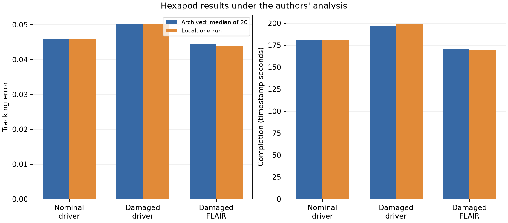
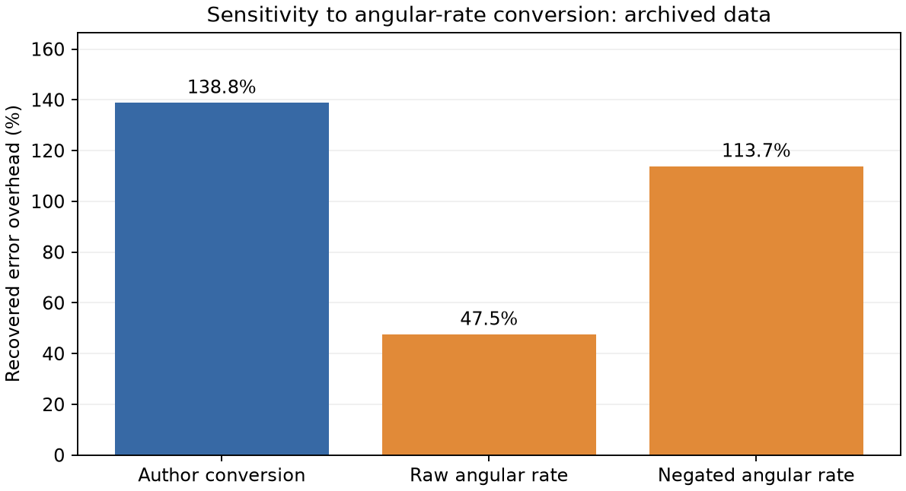

# FLAIR hexapod findings

The [FLAIR paper](https://www.nature.com/articles/s41467-026-70256-y) reports improved adaptation to a damaged leg. Reanalysis of the authors' [archived simulation data](https://zenodo.org/records/14546657) with their analysis recovered the published figures: **138.8% of tracking-error overhead** and **160.5% of completion-time overhead**. These are ratios of differences between condition medians; values above 100% mean the damaged FLAIR median was better than the nominal driver median under this metric. Each archived condition contains 20 runs.

One completed local run per condition using the [released example](https://zenodo.org/records/18336476) yielded 148.6% and 162.8%, respectively. These unpaired runs have unknown seeds and do **not** constitute a 20-run reproduction or a physical-robot result. The reported completion times use the example's synthetic timestamps, not host wall time.

The author's analysis converts angular rate as `-wz*pi/180`. Reanalyzing the archived data with raw `wz` or `-wz` changes the recovered tracking-error overhead to 47.5% or 113.7%, respectively. These are sensitivity checks, not validated replacement metrics; archived units and conventions remain uncertain. The released example also advances physics time ten times faster than its generated sensor timestamps, which can affect data matching.

In a separate 15-cycle instrumented comparison, CPU and GPU wall times were 51.88 s and 33.16 s, including initialization and compilation. This single short comparison does not establish steady-state performance.

The [archived analysis summaries](../results/flair_pilot/author_data_analysis_summary.json), [local comparison](../results/flair_pilot/author_three_condition_pilot.json), individual run scores and traces, and analysis scripts are retained alongside these figures.
