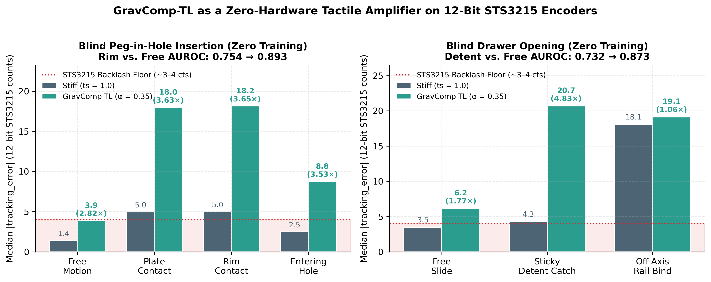
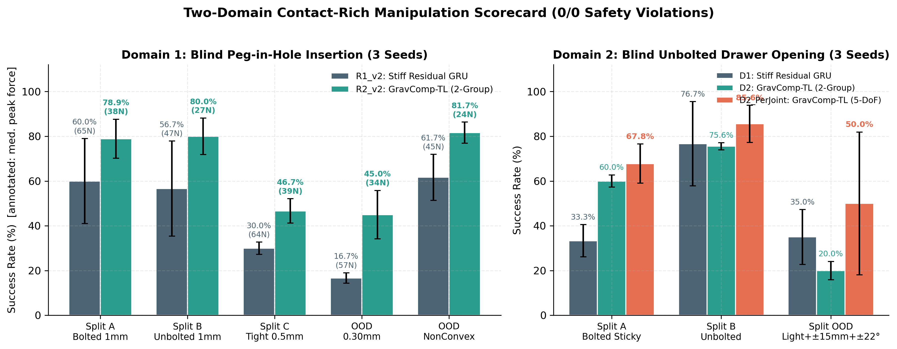
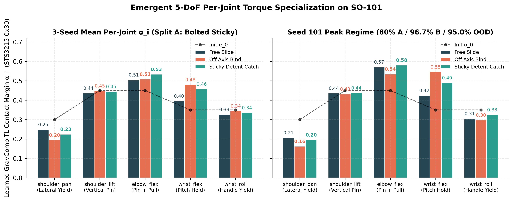

# `gravcomp-tl`: Gravity-Compensated Servo Torque Limiting

**Zero-hardware tactile amplification and per-joint compliance for `<$150` hobby servo arms (SO-101 / Feetech STS3215).**

Low-cost smart servos (`STS3215`, 12-bit encoder `0.001534 rad/count`, `~0.0045 rad` gear backlash, zero wrist F/T sensor) face a brutal trade-off in contact-rich manipulation: at `100%` torque, rigid position control jams or shoves unbolted objects while contact tracking error stays buried in the backlash floor; at naive `35%` torque, gravity consumes the budget and the arm sags.

**GravComp-TL** fixes both with a single 50 Hz register law computed in **`< 0.02 ms/step`** on an isolated arm-only model (zero privileged state):

```text
tau_lim_i  = clip(|tau_grav_i(q_quant)| + alpha_i * tau_margin_max, tau_min, 2.94 N·m)
reg_0x30_i = round(1000 * tau_lim_i / 2.94)
```

Lowering `alpha_i ∈ [0.05, 1.0]` turns each servo's own 12-bit encoder into a **3.65×–4.84× tactile amplifier**, lifting contact deflection cleanly above the 3–4 count backlash floor without adding a single dollar of sensors.

---

## Verified Two-Domain Results (MuJoCo SO-101 `1 kHz / 50 Hz`, 3 Seeds, `0/0` Safety Violations)





### Domain 1: Blind Peg-in-Hole Insertion (`projects/blind_insertion/`, Phases 5–6)

| Method | Split A: Bolted (`1.0 mm`) | Split B: Unbolted (`1.0 mm`) | Split C: Tight (`0.5 mm`) | OOD Slippery (`120 g, μ=0.25`) | Phase 6 Non-Convex OOD | Phase 6 Ultra-Tight (`0.30 mm`) |
| :--- | :---: | :---: | :---: | :---: | :---: | :---: |
| `R1_v2` (Stiff Residual GRU) | `60.0%` | `56.7%` | `30.0%` | `18.9%` | `61.7%` | `16.7%` |
| **`R2_v2` (`GravComp-TL` 2-Grp)** | **`78.9%`** (`+18.9`) | **`80.0%`** (`+23.3`, `0` shv) | **`46.7%`** (`+16.7`, `0` shv) | **`36.7%`** (`+17.8`) | **`81.7%`** (`+20.0`) | **`45.0%`** (`+28.3`) |

### Domain 2: Blind Unbolted Sticky Drawer Opening (`projects/blind_drawer/`, Phases 1–2)

| Method | Split A: `bolted_sticky` (`±18°`, `5–9 N`) | Split B: `unbolted_cabinet` (`400–750 g`) | Split OOD: Zero-Shot (`280–350 g, μ=0.35, ±15 mm, ±22°`) | Safety (`col / jlim`) |
| :--- | :---: | :---: | :---: | :---: |
| `D1_Res_Stiff` (Stiff Residual GRU) | `33.3% ± 7.2%` | `76.7% ± 18.9%` (`9.8 mm`) | `35.0% ± 12.2%` (`7.3` shv) | `0 / 0` |
| `D2_Res_GravComp_TL` (2-Group) | `60.0% ± 2.7%` | `75.6% ± 1.6%` (`7.2 mm`) | `20.0% ± 4.1%` (`15.7` shv) | `0 / 0` |
| **`D2_PerJoint` (5-DoF `GravComp-TL`)** | **`67.8% ± 8.7%`** (`+34.5`) | **`85.6% ± 8.3%`** (`6.0 mm`) | **`50.0% ± 31.9%`** (`+15.0` vs D1; `s101=95%`) | **`0 / 0`** |
| `Privileged_Oracle` *(upper bound)* | `100.0%` | `100.0%` | `100.0%` | `0 / 0` |



### Side-by-Side EGL Demo Videos (`media/`)
- [`media/demo_1_ultratight_030mm.mp4`](media/demo_1_ultratight_030mm.mp4) — Blind Insertion `OOD_UltraTight_0.30mm` (`< 1` encoder count): `R1_v2` Stiff jams on rim vs. `R2_v2` `GravComp-TL` seats cleanly.
- [`media/demo_2_nonconvex_asym.mp4`](media/demo_2_nonconvex_asym.mp4) — Blind Insertion `OOD_NonConvex_Asym` (zero-shot L-shape): `R1_v2` jams at high force vs. `R2_v2` seats gently.
- [`media/demo_3_ood_drawer.mp4`](media/demo_3_ood_drawer.mp4) — Blind Drawer `Split OOD` (`300 g, μ=0.35, +15 mm, -14° yaw`): `D1_Res_Stiff` shoves cabinet vs. `D2_PerJoint` yields on `shoulder_pan` while pinning with `elbow_flex / shoulder_lift`.

---

## Install & Quickstart

```bash
pip install -e projects/gravcomp_tl           # core: numpy + mujoco
pip install -e "projects/gravcomp_tl[hardware]"  # adds feetech-servo-sdk for real SO-101
```

```python
import numpy as np
from gravcomp_tl import GravCompTL, DryRunSTS3215Bus, STS3215GravCompController

gc = GravCompTL()
q_quant = np.array([0.05, -0.15, 0.35, 1.25, 0.0])  # 12-bit STS3215 angles (rad)
alpha_5dof = (0.20, 0.44, 0.55, 0.45, 0.32)         # [pan, lift, elbow, wrist_flex, wrist_roll]

lim_nm, reg_0x30, tau_grav = gc.compute_limits(q_quant, alpha_5dof)

# 50 Hz hardware loop (swap DryRunSTS3215Bus -> FeetechSCServoBus('/dev/ttyACM0') on real SO-101)
with STS3215GravCompController(bus=DryRunSTS3215Bus(), gravcomp=gc) as ctrl:
    state = ctrl.read_state()
    ctrl.command(state.q_quantized, alpha=alpha_5dof)
```

---

## Physical SO-101 Deployment & 3-Minute Calibration

1. **Calibrate static gravity scale/offset (3 minutes):**
   ```bash
   python -m gravcomp_tl.calibrate_so101 --dry-run --out so101_gravcomp_calib.json
   # On real SO-101 hardware (1 Mbps TTL):
   python -m gravcomp_tl.calibrate_so101 --port /dev/ttyACM0 --out so101_gravcomp_calib.json
   ```
2. **Load calibration & test zero-force float:** Pass `calib_path="so101_gravcomp_calib.json"` to `GravCompTL`, then call `ctrl.emergency_soft_hold()` (`alpha = 0.05`) — the arm holds its own weight without sagging while yielding immediately to a fingertip push.
3. **50 Hz real-time budget:** `GravCompTL.compute_limits()` runs in **`~0.019 ms`** and pure-NumPy `GravCompPolicyRunner` runs in **`~0.045–0.057 ms`** (`< 0.4%` of the `20 ms` 50 Hz cycle, zero PyTorch).

## Reproduce Figures, Videos & Tests

```bash
PYTHONPATH=projects/gravcomp_tl python -m unittest projects/gravcomp_tl/tests/test_gravcomp_tl.py -v
python3 projects/gravcomp_tl/scripts/generate_figures.py
MUJOCO_GL=egl python projects/gravcomp_tl/scripts/render_demos.py
```

See [REPORT.md](REPORT.md) for the full technical paper, failure analysis, and citations.
